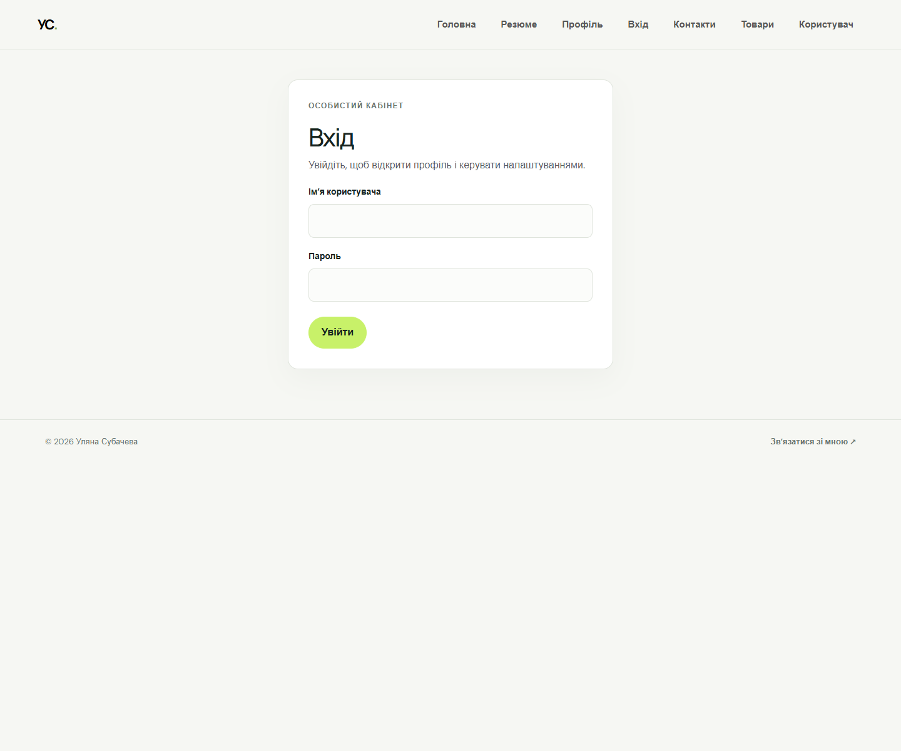
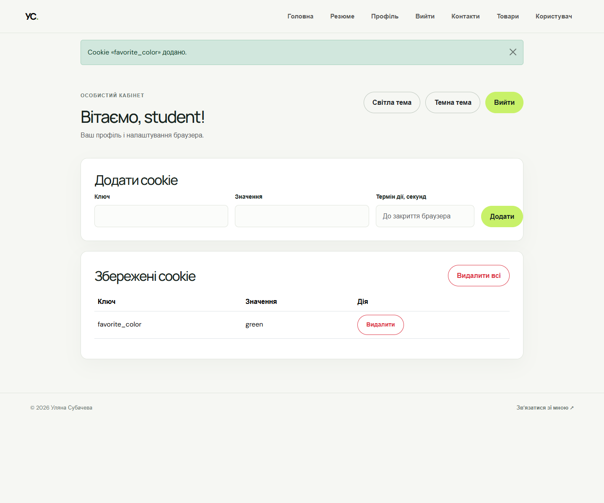
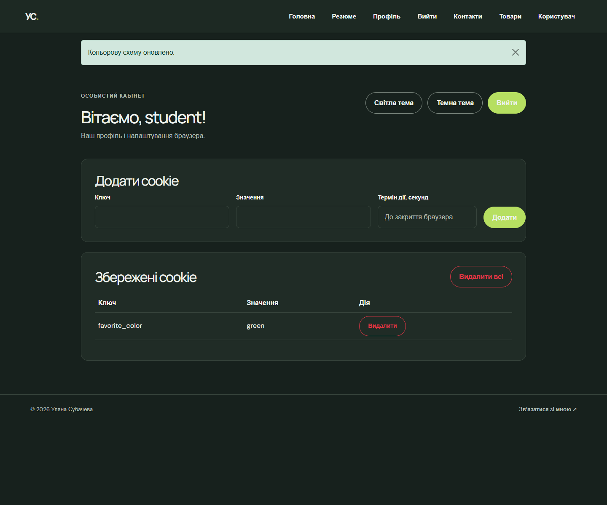

# Flask app — лабораторна робота 4

Навчальний Flask-застосунок на Blueprints із входом, профілем, сесіями, flash-повідомленнями, cookie та вибором теми.

## Запуск

```powershell
.\.venv\Scripts\Activate.ps1
$env:SECRET_KEY = "створіть-власний-випадковий-секретний-ключ"
python run.py
```

Залежності встановлюються командою `pip install -r requirements.txt`.

## Демонстраційний вхід

- Ім’я користувача: `student`
- Пароль: `flask123`

Ці облікові дані задано в коді як заглушку для лабораторної. У робочому застосунку замініть їх на автентифікацію з постійного сховища й використовуйте безпечне зберігання паролів.

## Сторінки

- `/` — головна;
- `/resume` і `/contacts` — резюме та контакти;
- `/users/login` — форма входу;
- `/users/profile` — профіль, керування cookie та вибір теми;
- `/users/hi/<name>?age=<age>` — привітання;
- `/users/admin` — перенаправлення до привітання адміністратора;
- `/products/` і `/products/<id>` — каталог та сторінка товару.

## Скріншоти

**Сторінка входу**



**Профіль зі світлою темою та збереженою cookie**



**Профіль із темною темою**



## Тести

```powershell
python -m unittest discover tests -v
```
